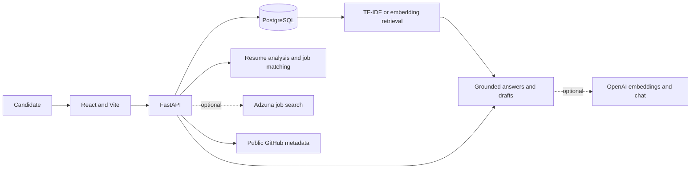

# CareerPilot AI

I built **CareerPilot AI** to make a job search more organized and less opaque. It brings candidate profiles, resume analysis, explainable job matching, and application tracking into one workspace.

I based job matching on TF-IDF similarity and skill evidence so people can inspect why a role matches their profile instead of relying on a black-box score. I also built a retrieval-based career assistant, with OpenAI embeddings and generated answers available as optional integrations.

## Highlights

- **Resume analysis:** Extract text and skill mentions from PDF and DOCX resumes, then use the results to help populate a candidate profile.
- **Explainable job matching:** Compare profile and resume text with job listings using TF-IDF cosine similarity, detected skill overlap, and available experience data. Review score components and skill evidence for each match.
- **Job discovery and saving:** Search live Adzuna listings when credentials are configured, search jobs already saved in your workspace without credentials, or add listings manually.
- **Application tracking:** Track statuses, application and interview dates, recruiters, follow-ups, and notes.
- **Grounded career assistant:** Retrieve relevant snippets from the user's profile, resume, and saved jobs. Optionally use OpenAI embeddings and chat completions for semantic retrieval and synthesized answers.
- **Writing and portfolio support:** Create editable application drafts, review skill gaps, inspect public GitHub metadata, and generate project ideas from recurring skills in saved jobs.

## Technology

| Area | Technologies |
| --- | --- |
| Frontend | React, Vite, JavaScript |
| API | Python, FastAPI, Uvicorn |
| Data | PostgreSQL, psycopg, JSONB |
| Matching and retrieval | scikit-learn TF-IDF, skill alias normalization, PyTorch cosine similarity |
| Optional AI | OpenAI embeddings and chat completions |
| Integrations | Adzuna job search, public GitHub API, optional OpenAI API |
| Local development | Docker Compose, Nginx |

## How It Works

1. **Build candidate context.** Users enter profile details and may upload a resume. The parser reads PDF text and DOCX paragraphs/tables, then detects skills using a small alias-aware vocabulary.
2. **Compare profile and roles.** The matching pipeline combines required/preferred skill coverage, TF-IDF text similarity, and available experience data. Results include score factors and matched/missing skills.
3. **Retrieve relevant information.** OpenAI embeddings can be stored with profile, resume, and job chunks and compared with PyTorch cosine similarity. Without an API key, the assistant uses local TF-IDF retrieval.
4. **Generate optional assistance.** OpenAI can answer from retrieved context and draft application text. Without an API key, the assistant returns retrieved information and source names; review generated text before use.



## Quick Start

### Requirements

- Docker Desktop with Docker Compose
- Ports `5173` and `8000` available

### Run with Docker Compose

From the project directory, copy the example configuration and start the services:

```sh
cp .env.example .env
sh run.sh
```

The launcher waits for the services to become healthy and opens the dashboard in your browser. The frontend is at [http://localhost:5173](http://localhost:5173). The API is at [http://localhost:8000](http://localhost:8000), with interactive documentation at [http://localhost:8000/docs](http://localhost:8000/docs).

To stop the services, run:

```sh
docker compose down
```

Compose stores PostgreSQL data in the `postgres_data` volume. To remove the local database data as well, run `docker compose down --volumes`.

## Demo Walkthrough

Use fictional information for a quick end-to-end demo:

1. Register an account and open **My Profile**.
2. Set the target role to `Junior Backend Engineer`, add `Python`, `FastAPI`, and `PostgreSQL` as skills, and add a short project entry such as `Built a REST API with Python and PostgreSQL`.
3. In **Find Jobs**, add a sample listing titled `Junior Backend Engineer` at `Example Labs`. Set the required skills to `Python`, `FastAPI`, and `PostgreSQL`, then include a short description of a backend API role.
4. Review the match explanation and save the listing to **Applications**.
5. In **Career AI**, ask which required skills are already evidenced in the profile and which need more project evidence.

The sample employer and profile details are fictional. The score is a ranking aid; it is not a hiring decision.

## Tests and Matching Benchmark

The backend tests use `pytest`. From the project root, run them in the API image with the source mounted into the container:

```sh
docker compose run --rm -v "$PWD/backend:/app" api sh -c 'pip install -r requirements-dev.txt && python -m pytest -q'
```

Run the synthetic matching smoke evaluation with:

```sh
docker compose run --rm -v "$PWD/backend:/app" api python evaluate_matching.py --k 3
```

The four-case built-in set is fictional and only checks simple expected behavior. Its current output is Precision@1 `1.000`, Precision@3 `0.333`, Recall@3 `1.000`, MRR `1.000`, and NDCG@3 `1.000`; these numbers do **not** measure real-world matching quality. To evaluate real examples, follow the consent, anonymization, labeling, and held-out-set guidance in [backend/evaluation/README.md](backend/evaluation/README.md) and pass a local JSONL dataset with `--dataset`.

## Configuration

Compose loads environment variables from `.env`; see [.env.example](.env.example) for the available settings and local defaults.

| Variable | Purpose |
| --- | --- |
| `POSTGRES_DB`, `POSTGRES_USER`, `POSTGRES_PASSWORD` | Local PostgreSQL database credentials. |
| `DATABASE_URL` | PostgreSQL connection URL used by the API. |
| `JWT_SECRET`, `JWT_EXPIRE_MINUTES` | Signing secret and token lifetime for authentication. |
| `CORS_ORIGINS` | Comma-separated list of permitted frontend origins. |
| `OPENAI_API_KEY` | Optional key for generated answers, writing drafts, and embeddings. |
| `OPENAI_MODEL`, `OPENAI_EMBEDDING_MODEL` | Optional OpenAI model selections. |
| `ADZUNA_APP_ID`, `ADZUNA_APP_KEY`, `ADZUNA_COUNTRY` | Optional configuration for live job search. |

OpenAI and Adzuna credentials are optional. Without Adzuna credentials, the search button filters jobs already saved in the account; add a listing manually or configure Adzuna credentials to search live listings. The GitHub integration reads public profile and repository metadata.

GitHub Actions runs backend tests, the synthetic ranking smoke evaluation, and container builds on pushes and pull requests. Automated deployment is not configured because no hosting target or deployment credentials are part of this repository.

## API Overview

Most endpoints require a bearer token returned by registration or login. Full schemas and interactive request examples are available in the FastAPI docs at `/docs`.

| Method | Endpoint | Purpose |
| --- | --- | --- |
| `GET` | `/api/health` | Service health check. |
| `POST` | `/api/auth/register`, `/api/auth/login` | Create an account or authenticate. |
| `GET`, `PUT` | `/api/profile` | Read and update the candidate profile. |
| `POST` | `/api/resume` | Upload and analyze a PDF or DOCX resume. |
| `GET`, `POST` | `/api/jobs` | List and save job listings. |
| `GET` | `/api/jobs/discover` | Search Adzuna when configured, otherwise search saved jobs. |
| `GET` | `/api/applications` | List tracked applications. |
| `POST` | `/api/applications/{job_id}` | Save a job to the tracker or update its status and details. |
| `GET` | `/api/dashboard` | Read profile completion, application counts, and top matches. |
| `POST` | `/api/assistant`, `/api/drafts` | Ask a career question or generate a draft. |
| `GET` | `/api/gaps/{job_id}` | Review skill gaps for a saved job. |
| `POST` | `/api/github/analyze`, `/api/portfolio/blueprint` | Review public GitHub metadata or generate a project brief. |
| `POST` | `/api/linkedin/suggestions` | Generate profile text suggestions for manual review. |

## Data and Responsible Use

- Resume uploads are limited to 10 MB and support PDF and DOCX. The uploaded file is parsed in memory rather than retained; extracted resume text and retrieval chunks are stored in PostgreSQL.
- Match scores are decision-support signals, not hiring decisions or guarantees. Detected skill mentions may not be mandatory requirements; check the original employer listing.
- Generated answers and drafts use available profile and job context but may be incomplete. Review all details before using or sharing them.
- CareerPilot does not scrape restricted job sites, access private GitHub repositories, log in to job boards, or submit applications automatically. GitHub analysis uses public profile/repository metadata and does not execute or comprehensively assess repository code.
- The Docker Compose configuration is for local development. A production deployment needs appropriately managed secrets, HTTPS, a strong unique JWT secret, restricted CORS origins, and a managed/backed-up database.
